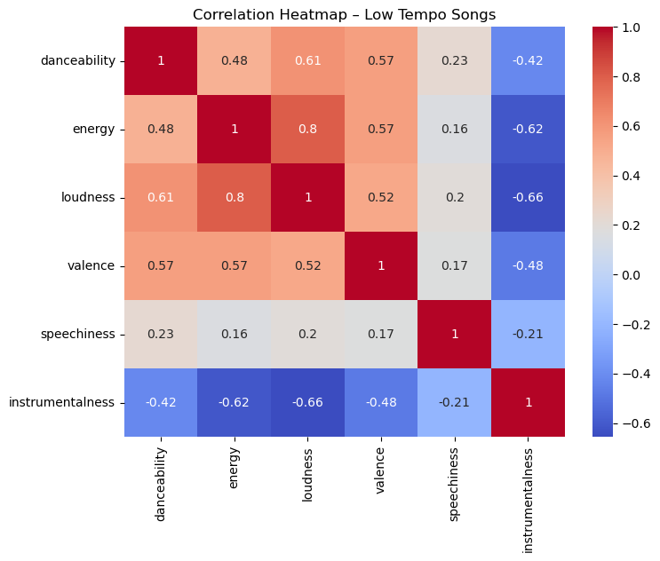

# Musical Trait Drivers of Danceability, Energy, and Popularity

**Course project · Purdue University · Jaash Thakkar**

A statistical analysis of Spotify audio features for high- and low-popularity tracks, looking at what makes songs danceable and energetic, and whether successful artists stay musically consistent.

## Research questions and findings

| Question | Method | Finding |
|---|---|---|
| **RQ1.** What drives danceability in low-tempo vs. high-tempo songs? | Correlation heatmaps | In low-tempo songs, danceability tracks most with **loudness (r = 0.61)** and **valence (r = 0.57)**, and falls with instrumentalness (r = −0.42) |
| **RQ2.** Are artists with repeat hits more musically consistent? | One-sample t-test on per-artist feature variability | Yes. Repeat high-popularity artists vary **significantly less** than the dataset overall (t = −26.24, p < 0.001) |
| **RQ3.** Do genres achieve energy through the same traits? | Global and per-genre Pearson correlations | **Loudness** is the top energy driver overall (r = 0.80) and in every genre analyzed; **acousticness** is the strongest negative driver (r = −0.75) |



## Data

- Two CSVs of Spotify tracks with audio features (danceability, energy, loudness, valence, tempo, acousticness, and more), split into high- and low-popularity groups
- **Source:** <!-- TODO: add the Kaggle (or other) link for the dataset -->
- The data isn't included in this repo. Download `high_popularity_spotify_data.csv` and `low_popularity_spotify_data.csv` into this folder to run the notebook.

## Run it

```bash
pip install -r requirements.txt
jupyter notebook spotify_trait_analysis.ipynb
```

## Tools

Python · pandas · NumPy · matplotlib · seaborn · SciPy
